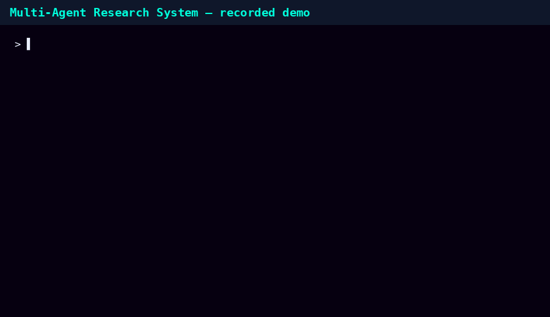
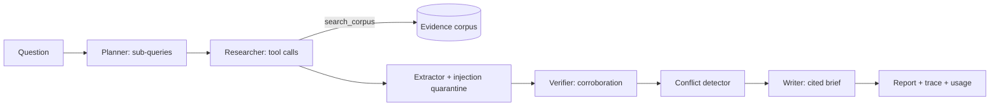

## Publish the recorded demo with GitHub Pages

This archive includes `index.html`, `style.css`, `app.js`, and `data.js` at the repository root for GitHub Pages. Create a GitHub repository, extract this ZIP, upload the **contents** (not the ZIP itself) to the repository root, then go to **Settings → Pages → Build and deployment → Deploy from a branch**, select `main` and `/(root)`, and save. Wait for deployment and use the exact URL displayed in Pages settings. The static demo works in recorded mode; Python API features require running or separately hosting the backend.

# Multi-Agent Research & Decision Intelligence System

Planner → Researcher → Extractor → Verifier → Conflict Detector → Writer: a multi-agent workflow that gathers evidence with tools, verifies claims by cross-source corroboration, surfaces **conflicting evidence instead of averaging it away**, and writes a cited brief.


*Animated demo rendered from real pipeline outputs. Interactive version: `app/static/index.html`.*

## Problem
LLM research assistants confidently merge sources that disagree, cite weakly-supported numbers as fact, and can be hijacked by instructions hidden in retrieved pages. Decision-makers need to know *what is corroborated, what rests on one source, and where sources conflict*.

## Architecture

Agents are functions over a shared state dict (`app/core/agents.py`) — LangGraph-compatible; tools are registered with JSON-schema validation (`app/core/tools.py`) in the same shape LLM function-calling APIs use (`GET /api/tools`).

## Easiest start (no FastAPI/Docker needed)
```bash
python run_local.py      # then open http://localhost:8000 — live demo with the real pipeline
```
`run_local.py` is a standard-library server exposing the same `/api` endpoints as the FastAPI app. Opening `app/static/index.html` directly (double-click) also works, in recorded-demo mode.

## Quick start (FastAPI)
```bash
python -m venv .venv && . .venv/bin/activate && pip install -r requirements-dev.txt
pytest -q
uvicorn app.main:app --reload          # UI on :8000, OpenAPI on /docs
python eval/build_dataset.py && python eval/run_eval.py
```
Docker: `cp .env.example .env && docker compose up --build`.

## Example output (real excerpts from two runs on the eval corpus)
```
What do the sources say about India electric vehicle sales in 2024 and 2025?
## Verified (2+ independent sources agree)
- India EV sales (2024): 0.96 million units [S1],[S2]
- India electric vehicle sales (2025): 1.2 million units [S2],[S3],[S4]
## Conflicting evidence (do not rely on either value)
- India solar installed capacity (2024): sources disagree — 88 GW [S2]; 118.8 GW [S1]
```

## Evaluation
**[EVAL_REPORT.md](EVAL_REPORT.md)** — status accuracy and conflict precision/recall vs a no-verification baseline, injection test, citation grounding, latency/cost. The numbers are modest by design: the evidence set is small, templated, and includes synonym noise the rule-based extractor can't normalize. Treat it as a reproducible harness, not a benchmark claim. `eval/judge.py` provides LLM-as-judge with human-agreement (Cohen's κ) validation; it needs an API key and was not run.

## Security
Sentences matching prompt-injection patterns are quarantined *before* claim extraction; tool arguments are schema-validated; sources are treated as data.

## Deployment
Container image (`Dockerfile`) runs anywhere (Render/Railway/Fly.io/Cloud Run). CI (`.github/workflows/ci.yml`): lint, tests, reproducible eval, Docker smoke test, GitHub Pages deploy of the static demo (recorded mode).

## Limitations & next steps
- Reference agents are rule-based (regex claim grammar, token-set subject keys). They fail on synonyms/abbreviations (see missed facts in the report) and on claims outside the grammar. Next: LLM extraction with schema-constrained output + embedding-based claim clustering.
- Verification = cross-source agreement, which can't detect correlated sources that copy each other; no source-credibility weighting yet.
- Corpus search is the only live tool; a web-search tool would need allow-listing and SSRF protection.
- No persistence, auth beyond a shared API key, or rate limiting. Eval is synthetic and small (12 facts).
